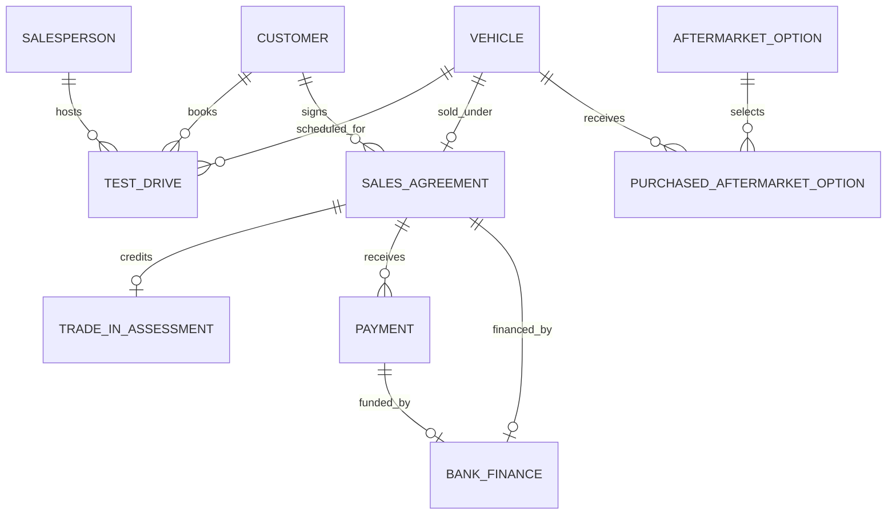

# Dealership Sales Database

A collaborative PostgreSQL project for an automotive dealership. The workflow module tracks a sale from test drive through agreement, trade-in, payment and financing. The reporting module tracks available and sold units, then summarises sales by make and model. They use separate schemas and synthetic demo records.

## Sales workflow

Ten related tables capture vehicles, customers, sales representatives, test drives, sales agreements, trade-ins, aftermarket options, payments and financing. Each vehicle has at most one agreement in this model.



- A trigger rejects aftermarket options for pre-owned vehicles. A composite foreign key also protects the rule when a vehicle record changes. Eight unique slots per vehicle enforce the option limit.
- `dealership.agreement_balance` derives the final price from the base price, discount, options and trade-in credit. It compares that amount with payments to show pending, completed or overpaid sales.
- A composite foreign key requires a financing record to reference a payment for the same agreement.

## Sales reporting

`sales_reporting.get_car_sales_summary()` returns available units, sold units, sales value and the latest sale date for each model, including models with no inventory. The Python data access module exposes that summary, a parameterised search and functions to register inventory or record a completed sale.

| Make and model | Available | Sold | Sales value | Latest sale |
| --- | ---: | ---: | ---: | --- |
| Orion Atlas | 1 | 2 | 54,450.00 | 2025-01-03 |
| Orion Orbit | 0 | 0 | 0.00 | — |
| Rivermark Summit | 1 | 0 | 0.00 | — |

The separate workflow fixture settles an agreement at **24,450.00** after a 1,000.00 discount, a 450.00 option and a 3,000.00 trade-in credit.

## Run locally

Use PostgreSQL 17 and a role that can create a database and schemas. Run these commands from the repository root. The SQL files are intended for a fresh database. Either schema and its seed can be loaded independently.

```bash
createdb dealership_demo
psql -X -v ON_ERROR_STOP=1 -d dealership_demo -f workflow/schema.sql -f workflow/seed.sql
psql -X -v ON_ERROR_STOP=1 -d dealership_demo -f reporting/schema.sql -f reporting/seed.sql
psql -X -v ON_ERROR_STOP=1 -d dealership_demo -f checks.sql
```

The checks exercise payment reconciliation, updates and deletions, option limits, finance consistency, zero-inventory models and duplicate sale attempts. The check transaction rolls back its changes.

Set the standard PostgreSQL connection variables for your local role. Both `psql` and the Python module accept `PGHOST`, `PGPORT`, `PGUSER` and `PGDATABASE`. Configure authentication through your local PostgreSQL setup or libpq password file.

```bash
python -m pip install -r requirements.txt
PGDATABASE=dealership_demo python -m reporting.database
```

In PowerShell, use `$env:PGDATABASE = 'dealership_demo'` before running `python -m reporting.database`.

## 中文简介

这个项目用 PostgreSQL 实现汽车经销商的销售流程和库存报表。销售流程展示如何校验加购规则、追踪融资付款并核对成交余额。报表模块按品牌和车型汇总库存、销量、销售额及最近成交日，使用合成数据复现。
